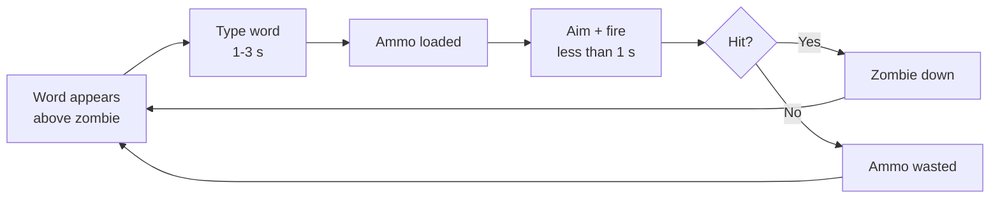
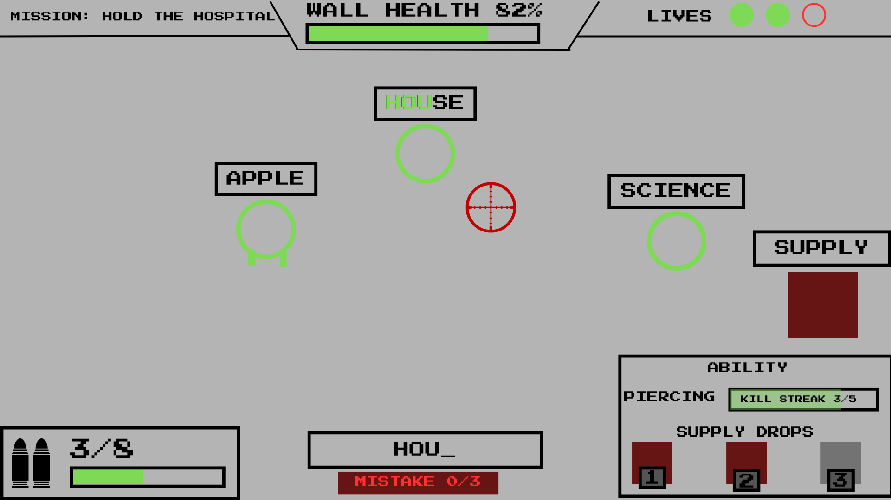
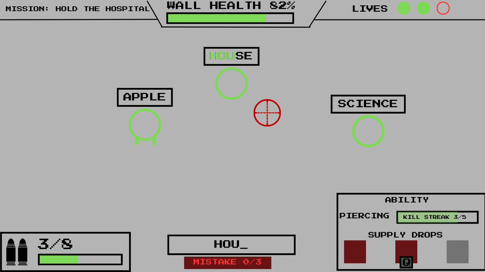

# Dead Keys - Game Design Document

| | |
|---|---|
| **Team** | Dead Keys (solo for Milestone 1; team of four from Milestone 2) |
| **Members & roles** | Romart Danganan (design lead, lead programmer, producer, integration and testing, HUD and item art); William Johnston (enemies, wave spawning, pooling, barrier ring); Nicole Lai (progression, gold and save, mission unlocks, word lists, zombie sprite sheets); Josiah Natanielu (mistake and combo systems, audio, mission end screens, How to Play). All four are CGRA 359 programming students; backgrounds and logos were drawn by Romart's partner. |
| **Engine / platform** | Godot 4.7 / Windows, Linux (primary), macOS (secondary) |
| **Repo** | https://gitlab.ecs.vuw.ac.nz/course-work/cgra359/2026/assignments/danganroma/dead-keys |
| **Doc version** | v1.5 |
| **Last updated** | 17/10/2026 |

## Changelog

| Version | Date | Change | Who |
|---|---|---|---|
| v0.1 to v0.6 | 2026-07-12 | Initial GDD development: drafted the core concept and gameplay loop; expanded scope, controls, combat, enemies, typing and mistake systems; added movement, interactive objects, balance data, economy, progression, saving, screen flow, narrative, and level planning. | Romart Danganan |
| v0.7 | 2026-07-13 | Added interface, controls, accessibility, and AI design | Romart Danganan |
| v0.8 | 2026-07-14 | Final Draft For Assignment 1 Submission, further tweaks needed to GDD before Final Submission. | Romart Danganan |
| v0.9 | 2026-07-15 | Large review and edits to logic and game mechanics: Call Supply moved Q→RMB, ammo tiers now scale bullet count only (not type), added mistake-system accessibility toggle, unified combo/kill-streak into one Combo counter, added Permanent Upgrade Tracks table (§2.6.1); locked scope to a single upgradeable weapon (multi-weapon flagged as deferred stretch idea); removed player-position-based supply drop and zombie-collision crate removal; removed on-screen player-character framing (no player model), simplified help-system tooltips, added word-label overlap/priority rule | Romart Danganan |
| v1.0 | 2026-07-22 | Retouched Call Supply from RMB→Nums(1 to 3) and added enemy types to scope | Romart Danganan |
| v1.1 | 2026-07-29 | Refined the Main Menu and Home Base design: added replaceable illustrated logo/background placeholders, gold display, upgrade/supply/ability panels, reusable illustrated mission cards, sequential mission locking, selected-mission details with best medal, and navigation back to the Main Menu. Removed XP from the hub design because XP is not part of the progression model. | Romart Danganan |
| v1.2 | 2026-08-24 | Milestone 2/3 documentation sync (#16, overdue from Milestone 2). Updated MoSCoW table statuses and milestone references to match the actual sprint schedule (`milestone2.md`) instead of the original week numbers. Added concrete Mission Supplies crate effects (§2.2.4) now that they're implemented, including the Emergency Crate redesign from jam-clear to a wall damage reduction plus partial ammo refill (originally scoped as jam-clear in issue #29, changed after review found clearing a jam took about as long as typing the crate's own word). Documented that a Supply is consumed the moment its call is made, not only on a successful claim, an implementation decision made during #29. Filled in Magazine Capacity's per-level values (§2.6.1), left blank in the original table. Updated §10 to reflect that GUT unit testing (#34) is implemented, not just planned. | Romart Danganan |
| v1.3 | 2026-09-26 | Sprint 5 documentation sync (#51). Header updated to list the full team. MoSCoW statuses updated to match `dev`: all four launch abilities done (#24, #36, #37, #38), gold/save and permanent upgrades done (#25, #26), Walker, Runner and Medic done (#11, #27, #39) with Brute still open (#30), Mission 1 done (#42) with Mission 2 open (#31), Mistake-system toggle built in the Settings menu (#46, in review). Added rows for the Pause menu, Settings menu and audio system. §2.8 and §7 now separate what a player can actually change in the Settings menu from options that are deferred past Milestone 3 (word-difficulty assist, typing-speed assist, colourblind palette, screen-shake/flash, subtitle size, hold-to-fire). §2.8 save model updated to match what ProgressionManager actually persists. Ammo reward now scales with word length as §2.2.1 always specified (#50), so no rule change was needed there. | Romart Danganan |
| v1.4 | 2026-10-16 | Final sync with the Milestone 3 build. Scope cut recorded in §1.6 and §5.2: Missions 4 to 6, the second boss and the Spitter, Exploder and Armoured enemies are cut; Endless mode added (§5.3). §2.1 adds the separate Use Ability input. §2.2.3 rewritten for what playtesting changed: the ability charges from 5 typed words in a row (not kills) and is fired by the player with its own input, with all eight abilities and their numbers listed, plus the flat 200 gold ability economy. §2.2.2 records the Mistake Leniency behaviour. §2.5 enemy table updated to the shipped values (Medic heals 5 HP/s only after 2 s unhit, Commander, Tank boss) with a new boss fight section (§2.5.1). §2.6 rewards and medals as built, perfect accuracy bonus built into medals. §2.8, §6, §7 list the shipped Settings and Accessibility options (zombie speed, longer crate timer, large word text, hold to fire, reduce flashing, reduce screen shake). §3 screen flow adds How to Play, Endless and the two mission end screens. §8.1 describes 360 degree edge spawning, the barrier ring and equal arrival time. §8.3 drops the unbuilt Drone. §9 records the art sources and the design gap. §11 records the three playtests. | Romart Danganan |
| v1.5 | 2026-10-17 | Consistency pass before submission. §2.1 and §2.4 now describe the shared typed prefix and the Use Ability input instead of the old single target and next shot rules. §2.6 supply prices corrected to 60 to 120 coins. §4.2 and Fig. 5 note that only three missions were built. §10 describes where data really lives. §11 session length matches §1.3 and playtest #3 is described as a scripted session with a human session to follow. | Romart Danganan |
---

# 1. Page One - The Core

## 1.1 Hook

For typing-game players who want a real skill ceiling, and arena-shooter players who want a hook they haven't seen, Dead Keys is a top-down zombie-defense shooter where typing loads your gun but never fires it. Every zombie carries a word above its head; typing it converts into ammunition, but the player must then manually aim and shoot, with no lock-on. Typing skill decides how much ammunition exists. Aiming skill decides whether it's spent well.

## 1.2 Design pillars

| Pillar | What it means | Consequences (what it forbids/forces) |
|---|---|---|
| 1. "Typing earns, aiming spends" | Typing and damage are never the same action. | Forbids any mechanic where a completed word directly damages an enemy. Forces every new system (abilities, supplies) to resolve through a manual aim/fire action, never an automatic one. |
| 2. "Choose your run before you start it" | Build variety lives in a pre-mission menu, not in mid-run pickups. | Forbids randomised or mid-mission power-ups. Forces the ability and Mission Supplies systems to both be locked in before the mission starts and unchangeable once it does. |
| 3. "Mistakes cost something now, not later" | Typing errors have an immediate, visible, in-combat consequence. | Forbids delayed or score-only penalties (e.g. a mistake that only affects the end-of-mission rating). Forces the mistake system to stay to one primary and one secondary punishment, so it stays legible mid-combat. |

## 1.3 Core loop



- **Moment loop (seconds):** word appears, type it (1 to 3 s depending on length), aim, fire (under 1 s). A full cycle is roughly 2 to 4 seconds, repeated continuously against multiple simultaneous zombies.
- **Session loop (minutes):** one mission, roughly 2 to 5 minutes, ending in a mission-rating screen (medal from typing accuracy, wall health left and lives lost, see §2.6). A meaningful session is **one full mission**, or one Endless run.
- **Meta loop (hours):** Home Base, buy upgrades and supplies, choose one ability, select a mission, fight, earn coins, unlock gear, repeat. The shipped game has three campaign missions plus Endless mode; medal-hunting on earlier missions with better gear and chasing an Endless high score extend it further.


*Fig. 1 - the meta loop shown above, as it appears to the player: Home Base to Mission and back.*

## 1.4 Audience & genre

Casual-to-mid-core PC players aged roughly 12 and up: the existing typing-game audience (students, ESL learners, edutainment crossover players) plus twin-stick/arena-shooter fans wanting a lighter, session-based game. Comparisons:

- **Epistory: Typing Chronicles / ZType** - typing games where typing itself is the damage action. We take the readable floating-word convention, reject the direct-damage model, since it caps the skill ceiling at typing speed alone.
- **Plants vs. Zombies** - casual tower/base-defense structure and tone. We take the stylised, non-horror zombie aesthetic and the permanent, deterministic upgrade economy; we reject its lane-based grid, since our combat is free-aim.

## 1.5 Look, feel, and tone

Stylised, slightly cartoonish 2D top-down, closer to Plants vs. Zombies than Left 4 Dead: high-contrast silhouettes, minimal visual noise around zombie heads and the typing input area (both must be readable at a glance mid-combat), upbeat arcade-tense music rather than dread-horror scoring. Full direction in §9.

## 1.6 Scope: goals and non-goals

### Non-goals

- No open world or free player movement; the player is stationed at a fixed base position, missions are discrete hand-authored encounters.
- No randomised loot, gacha-style unlocks, or mid-mission power-up pickups; all progression is coin-purchased and deterministic.
- No online multiplayer or networking this trimester.
- No controller support at launch; keyboard and mouse only, since typing is the core mechanic.
- No procedurally generated levels or navmesh pathfinding; arenas are open, zombies spawn just off the screen edge in any direction and walk straight toward the barrier ring around the base (see §8.1).
- No dedicated skippable tutorial level; onboarding happens inside Mission 1 (see §5.1).
- No cheats or easter eggs this trimester.
- No multiple purchasable weapons at launch; a single weapon with upgradeable fire rate and damage covers the Weapon upgrade track (§2.6.1). A pistol → heavy pistol → rifle weapon-swap progression was discussed as an appealing option for immersion but is deliberately deferred as a stretch idea, not committed scope, given the one-trimester timeline.
- No rendered player character/avatar on screen; the player experiences the game from a fixed POV (aim reticle + HUD only, see §4.3).

### MoSCoW scope table

| Feature | Priority | Milestone | Owner | Status |
|---|---|---|---|---|
| TypingController + AmmoSystem | Must | Milestone 2 | Romart Danganan, Nicole Lai | done (word-length ammo scaling #50) |
| Manual aim/fire + mistake system | Must | Milestone 2 | Romart Danganan, Josiah Natanielu | done |
| Home base, shop, ProgressionManager | Should | Milestone 3 | Romart Danganan, Nicole Lai | done (Upgrade Shop #25, gold/save #26, Mission Supplies #29, mission unlocks #32) |
| Ability loadout system (4 abilities) | Should | Milestone 3 | Romart Danganan | done (Spread Shot #24, Ricochet #36, Freeze Round #37, Piercing Shot #38) |
| Mission Supplies system | Should | Milestone 3 | Romart Danganan | done (#29) |
| Missions 1-3 + first boss | Should | Milestone 3 | Romart Danganan | done (Mission 1 #42, Mission 2 #31, Mission 3 and Tank #63, boss fight #67) |
| First 4 enemy types (Walker, Runner, Brute, Medic) | Should | Milestone 3 | William Johnston | done (Walker #11, Runner #27, Medic #39, Brute #30) |
| Pause menu | Should | Milestone 3 | Romart Danganan | done (#44) |
| Settings menu (volume, display, controls) | Should | Milestone 3 | Romart Danganan | done (#46) |
| Audio / SFX and music | Should | Milestone 3 | Josiah Natanielu | done (#40, #57) |
| Tutorial callouts and How to Play | Should | Milestone 3 | Romart Danganan, Josiah Natanielu | done (#60, #58) |
| Mission success and failed screens | Should | Milestone 3 | Josiah Natanielu | done (#52, #56) |
| Mistake-system accessibility toggle | Could | Milestone 3 | Romart Danganan | done (#46) |
| Accessibility options for slower typists | Could | Milestone 3 | Romart Danganan | done (#66, added after playtest #2) |
| Remaining 4 enemy types (Spitter, Exploder, Commander, Armoured) | Could | Milestone 3 | William Johnston | Commander done (#30); Spitter, Exploder and Armoured cut |
| Remaining 4 abilities | Could | Milestone 3 | Romart Danganan | done (#54) |
| Missions 4-6 + second boss | Could | Milestone 3 | Romart Danganan | cut (see below) |
| Mission rating / medals | Could | Milestone 3 | Romart Danganan | done (#65) |
| Endless mode | Could (added) | Milestone 3 | Romart Danganan | done (#68) |
| Multiple purchasable weapons | Won't (this trimester) | - | - | deferred stretch idea |
| Online multiplayer | Won't | - | - | non-goal |
| Controller support | Won't | - | - | non-goal |

*Scope cut (v1.4): `milestone2.md` set the cut order in advance (second boss and half the abilities first, the core loop never). All eight abilities were built by early October, so the cut moved to content. Mission 4 with the Spitter and Exploder was a stretch goal that depended on Brute and Mission 3 being merged by 9 October; they merged on 8 and 9 October, leaving too little time before the 14 October feature freeze. Missions 4 to 6, the second (Mutant) boss and the Spitter, Exploder and Armoured enemies are cut. Endless mode was added instead because it reuses every built enemy and system and gives the three missions replay value.*

---

# 2. Gameplay & Mechanics - owner: Romart Danganan

## 2.1 Player verbs & controls

| Verb | Input | Timing / numbers | Notes |
|---|---|---|---|
| Type word | Keyboard (A-Z) | 1 to 3 s per word, validated character by character | Every word on screen is checked against one shared typed prefix (§2.2.1) |
| Aim | Mouse move | Continuous, no acceleration curve, free 360° | Independent of typing |
| Fire | Left mouse button (rebindable) | 0.5 s cooldown at base fire rate (2 shots/s), upgradeable to 4 shots/s | Consumes 1 ammo unit per shot |
| Use Ability | Right mouse button (rebindable) | Only when the ability is charged | Fires the equipped ability toward the cursor, costs 1 ammo like a normal shot |
| Use Supply | Number keys 1-3 | 3 s helicopter flight time before crate lands | Each key activates the supply shown in the matching numbered HUD slot; only usable if that slot contains a supply |
| Select ability / mission | Mouse click, UI | Pre-mission only | Locked once the mission starts |

*Design note: Supplies use the number keys 1-3 rather than letter keys, because letter keys are reserved for typing zombie and crate words. Each numbered key maps directly to the supply icon carrying the same number in the HUD, allowing the player to choose a specific purchased supply without interfering with normal typing.*

## 2.2 Systems & rules

### 2.2.1 Ammunition System

- **Intent:** pillar 1, typing generates the resource; it never deals damage directly.
- **Rules:** word length maps to **bullet count only, not bullet type**: 3-4 letters = 1 bullet, 5-7 letters = 2 bullets, 8-10 letters = 3 bullets, 11+ letters = 4 bullets. All bullets are the same type and deal the same base damage (see §2.5). Words are drawn from a per-mission, difficulty-tiered word list (data-driven, see §10). Ammo sits in inventory until manually fired; there is no auto-fire.
  *Design note: earlier drafts had the 8-10 and 11+ tiers produce special "charged" and "explosive" bullet types. This is simplified to a single bullet type at increasing quantity - bullet-type variety (Piercing/Explosive-style effects) now belongs solely to the Ability system (§2.2.3) if implemented, so the Ammo System's only job stays "how much," not "what kind," consistent with pillar 1.*
- **Edge cases (as built):** two on-screen targets never share a word; the typing controller only hands out words not already in use, so a typed prefix always narrows to one target. Every word that still matches the typed prefix stays highlighted until the player's next key narrows it. A finished zombie word is replaced with a new word on the same living zombie, so the player can always earn ammo while a zombie is alive. If the player finishes a word while ammo is at its cap, the extra is discarded and the popup shows "AMMO FULL". The planned label priority and stagger rule for overlapping words was not built; instead zombies are spread out by 360 degree spawning and the barrier ring (§8.1). Playtest #3 measured overlap in 12% of samples in Mission 2 and 0% elsewhere.

### 2.2.2 Mistake System

- **Intent:** pillar 3, immediate and legible consequences.
- **Rules:** each incorrect keystroke costs 1 bullet from current ammo. Three consecutive mistakes (no correct keystroke between them) trigger a 2 second weapon jam, during which the Fire input is ignored. The Combo counter (§2.7) resets to 0 on any mistake (see §2.2.3 for how this now also affects ability progress). The entire mistake system (bullet loss + jam) can be switched off as an accessibility/assist option (§2.8) - with it off, incorrect keystrokes simply aren't counted toward the word and cost nothing. This is offered as a difficulty/assist choice, not forced on.
- **Edge cases:** if a mistake happens while ammo is already 0, no bullet is lost, but the consecutive-mistake counter still increments toward the jam threshold. If a jam triggers while a shot is mid-cooldown, the pending shot is discarded and the jam timer starts immediately. Mistakes made during an active jam still cost a bullet but do not build toward another jam (#20).
- **Mistake Leniency (as built):** the Mistake Leniency upgrade (§2.6.1) lets the first one or two mistakes in a row cost nothing: no bullet and no Combo reset. The jam threshold itself stays at three.

### 2.2.3 Ability System

- **Intent:** pillar 2, a class-like choice made before the mission, not a mid-run pickup.
- **Rules:** exactly one ability is equipped from the Ability Select screen before a mission starts; it cannot be changed or stacked once the mission begins. A single **Combo** counter (shown in the HUD, §6.1) counts words typed in a row without a mistake; zombie words and supply crate words both count. 5 words in a row charges the ability. The charge is stored and the player fires it when they choose with the Use Ability input (§2.1); it costs one bullet like a normal shot. While a charge is stored the Combo pauses, so charges never stack. The Combo resets to 0 on a mistake (§2.2.2) or when a zombie reaches the barrier ring.
  *Design note (v1.4, #64): the ability first charged from 5 kills in a row and fired automatically on the next shot. Playtesting showed two problems: kills depend on aim and ammo as much as typing, and an automatic ability often went off on a single zombie. Charging from typed words rewards the game's core skill, and a separate input lets the player choose the moment. Charging is now more frequent, so 5 words may need raising after human playtesting.*
- **Edge cases:** an earned charge persists until it is used, even if the Combo resets in the meantime. If the mission ends before the charge is used, it is discarded (abilities do not carry between missions).
- **Abilities (as built):**

  | Ability | Effect | Cost |
  |---|---|---|
  | Spread Shot | 3 bullets in a cone, 25 degrees either side | Owned from the start |
  | Ricochet | Bounces to the 2 nearest on-screen zombies after its first hit, 3 zombies hit in total | 200 gold |
  | Piercing Shot | Passes through every zombie in its path until it leaves the arena | 200 gold |
  | Freeze Round | Fully freezes the hit zombie and every zombie within 140 px for 2.5 s | 200 gold |
  | Explosive Round | Every zombie within 200 px of the impact takes 2x bullet damage | 200 gold |
  | Heavy Round | 5x bullet damage on the zombie it hits | 200 gold |
  | Homing Shot | Curves toward the nearest on-screen zombie it has not hit yet | 200 gold |
  | Shockwave Round | Pushes every zombie within 120 px of the impact 150 px back, as a smooth 0.3 s slide | 200 gold |

  *Design note: the four launch abilities were redesigned before implementation so that each has its own job (spread, bounce, pierce, crowd control) instead of being four damage boosts. Abilities are bought once on the Ability Select screen for a flat 200 gold, separate from the Upgrade Shop. All radii and costs are first-pass numbers. Ricochet currently beats Spread Shot against groups; Spread Shot only wins on a single tough target.*


*Fig. 3 - one ability equipped; no switching once the mission starts.*

### 2.2.4 Mission Supplies System

- **Intent:** pillar 2 (secondary layer) plus an ongoing coin sink (§2.6).
- **Rules:** before a mission, coins purchase Supplies (Ammo Crate, Medical Crate, Combat Crate, Emergency Crate); up to 3 purchased supplies are placed into numbered HUD slots 1-3 for that mission, with one supply in each occupied slot. Pressing the number key that matches a supply's HUD icon triggers that specific helicopter drop; the crate lands at a designated supply-drop landing spot (a fixed point per arena) after a 3 s flight. A word then appears above the crate; the player has 8 seconds (12 with the Longer Crate Timer accessibility option) to type it before the crate expires and is removed. A successful type opens it immediately and applies the crate's effect. Only one crate can be active at a time; another supply cannot be activated while a crate is live and unclaimed.
  *Design note: the crate's landing point was originally described as "within 4 m of the player's position" - but there is no on-screen player character to anchor that to (§4.3), so it's now a fixed designated drop spot per arena instead. The earlier rule where a zombie colliding with the crate also removed it has been cut; the 8 s timer alone is enough pressure without adding a second failure state.*
  *Design note (added in implementation, #29): a Supply's numbered slot empties the moment its call is made (the number key is pressed), not only on a successful claim. This was chosen over the strictly claim-only version originally implied above, since "pressing the key is the commitment" is a simpler mental model, matches the existing "activation is player-triggered" framing below, and avoids a case where a missed crate leaves the player unsure whether their supply is still available.*
- **Crate effects:**

  | Crate | Effect |
  |---|---|
  | Ammo Crate | Refills ammunition to maximum capacity |
  | Medical Crate | Repairs the wall for 50% of its maximum health |
  | Combat Crate | +50% bullet damage for the rest of the mission |
  | Emergency Crate | Reduces wall damage taken by 50% for 15 seconds, and refills 50% of maximum ammunition |

  *Design note (#29): the Emergency Crate was originally scoped as an instant jam-clear plus full ammo refill. Changed after review: typing the crate's own word takes about as long as the jam it would be clearing, so the effect barely mattered in practice. The wall-damage-reduction version gives it a distinct niche (a "breathing room" panic button) rather than overlapping with the Ammo Crate. Exact numbers (50%/15s/50%) are a first-pass balance choice, not playtested yet.*
- **Edge cases:** pressing a number whose supply slot is empty does nothing, and its HUD icon remains visibly empty. Pressing another occupied supply slot while a crate is already active also does nothing. Supplies are never lost for a mission ending early, since activation is player-triggered rather than scheduled (this preserves the original pitch's core insight about player agency).



*Fig. 6 - the player calls a drop, then types the crate's word before it expires.*

## 2.3 Movement & physics

There is no player character to move; combat is entirely aim-and-fire from a fixed POV (there is no player movement verb, deliberately, see non-goals). Bullets are simple projectiles, not hitscan, so leading a moving target is part of the aim skill: base bullet speed 18 m/s, no gravity (top-down), linear travel, circle-collider hit detection. This is an explicit decision, not an engine default, chosen because projectile travel time is what makes aiming skill-expressive rather than trivial.

## 2.4 Objects & interactions

| Object | Interaction | State carried |
|---|---|---|
| Zombie | Type its word to load ammo; aim and shoot to kill | Word, health, speed, word-difficulty tier |
| Supply crate | Type its word within 8 s to claim | Word, effect type, time-to-live |
| Base wall | Takes damage from zombies that reach it | Current health, current lives |
| Ability charge | Earned from 5 typed words in a row, fired with the Use Ability input | Charged / uncharged |

## 2.5 Combat / conflict

Base fire rate 2 shots/s (0.5 s cooldown), upgradeable to 4 shots/s. Bullet damage: all bullets deal 10 base damage per hit (bullet **count** scales with word length per §2.2.1, not bullet type). Piercing/Explosive-style damage modifiers, if implemented, come from the Ability system (§2.2.3) rather than from the ammo tier. Enemy health and behaviour:

| Enemy | Health | Speed (px/s) | Notes (as built) |
|---|---|---|---|
| Walker | 30 | 30 | Baseline, no special behaviour |
| Runner | 15 | 100 | Zigzags as it approaches, short words (1 bullet), drawn as a zombie dog |
| Brute | 150 | 15 | Slow, large, tagged for long words |
| Medic | 25 | 30 | Heals nearby damaged zombies at 5 HP/s, but only once a zombie has gone 2 s without being hit |
| Commander | 30 | 20 | Stops while other zombies are within 240 px and speeds them up by 20% |
| Tank (boss) | 500 | 12 | Mission 3 boss and every fifth Endless round; 20 wall damage per hit, 8+ letter words only, enters from the sides; see §2.5.1 |
| Spitter | - | - | Cut (v1.4) |
| Exploder | - | - | Cut (v1.4) |
| Armoured | - | - | Cut (v1.4) |

*Design note (v1.4): the Medic originally healed 10 HP/s continuously. At the base fire rate of 2 shots/s for 10 damage, it put 5 HP back between every shot and a Walker took 5 bullets instead of 3, while one word only gives 1 to 4 bullets. Halving the rate and adding the 2 s delay means a 3 shot burst always lands before any heal, so healing only punishes leaving a zombie half dead. The Commander kept the engine default of 30 health instead of the planned 40.*

### 2.5.1 Boss fight (Tank)

The Tank fight is designed to be livelier, not harder. Every phase change gives the player a breather or a shortcut:

- **Entrance:** "BOSS INCOMING" banner, a camera shake and zoom pulse, and a boss health bar with marks at 66% and 33%.
- **Phase 2 (66%):** the Tank roars, staggers for 2.5 s and calls two cats (Walkers) with short words. The roar pushes every zombie within 150 px of it 120 px away from the base, and if the Tank is closer than 180 px past the ring it is pushed back out to that distance, so helpers never spawn on top of the base. Helpers spawn behind where the Tank lands.
- **Phase 3 (33%):** "ARMOUR CRACKED" removes a third of its remaining health, the Tank roars again, calls two dogs (Runners) further back than the cats, then enrages (+25% speed, red tint).
- **Finale:** the camera zooms to 1.8x on the Tank while its death plays at quarter speed, then zooms out while every other zombie dies, and the mission ends. In Endless mode a Tank only gets a short slow motion and the run continues.

*Design note: "extra lives" appears as a Base upgrade in the original pitch's progression list, but no fail-state used it. Formalised here: each mission starts with 1 life (purchasable up to 3, see §2.6.1). When wall health hits 0, one life is lost and the wall resets to 50% health if a life remains; the mission fails only once the last life is lost.*


*Fig. 4 - speed, health, and word length across the enemy roster.*

## 2.6 Economy & resources

- **What resources does the player have:** a single currency, coins.
- **How do they earn them:** a base reward per completed mission (50, 75 and 100 coins for Missions 1 to 3), plus a medal bonus (+25 bronze, +50 silver, +100 gold), plus a perfect-accuracy bonus of 10% of the base reward for a mission with no typing mistakes. Endless mode pays no coins so it cannot be used to skip campaign progress.
- **Medals (as built, #65):** gold needs 95%+ typing accuracy, 60%+ wall health left and no lives lost; silver needs 85%+ accuracy and 30%+ wall health (a lost life is allowed); any other win is bronze. A failed mission gives no medal. The best medal per mission is saved and a worse result never replaces it. Accessibility options never lower the medal.
- **How do they spend them:** permanent one-time Weapon/Base/Typing upgrades (100 to 500 coins each, see §2.6.1), and Mission Supplies, which must be repurchased every mission (60 to 120 coins each), keeping coins useful even after most permanent gear is bought out.
- **Why do they want more:** to unlock the remaining permanent upgrades, and because Supplies are a recurring cost that never runs out of relevance.
- **Starting values:** 0 coins. Mission 1 (Defend the Suburbs) is completable with no purchased upgrades or supplies, so there is no economic gate on entry.

### 2.6.1 Permanent Upgrade Tracks

The game ships with **one weapon** (see §1.6 non-goals), so weapon progression is entirely upgrade-driven rather than gear-swap-driven. Costs below are a rough first pass, scaled against the 50-150 coins/mission earn rate in §2.6 - early levels should be affordable off 1-2 missions, later levels are a multi-mission save.

| Upgrade | Track | Effect per level | Levels | Rough cost (coins, per level) |
|---|---|---|---|---|
| Fire Rate | Weapon | 2.0 → 2.5 → 3.0 → 4.0 shots/s | 3 | 150 / 250 / 400 |
| Bullet Damage | Weapon | +2 dmg/hit per level (10 base) | 3 | 150 / 300 / 500 |
| Magazine Capacity | Weapon | 8 → 12 → 16 → 20 max ammo | 3 | 100 / 200 / 350 |
| Fortified Wall | Base | +25 max wall health per level | 3 | 100 / 200 / 350 |
| Extra Life | Base | +1 life (starts at 1, caps at 3) | 2 | 300 / 500 |
| Jam Duration | Base | Jam length 2.0s → 1.5s → 1.0s | 2 | 150 / 250 |
| Mistake Leniency | Base | Mistakes-before-bullet-loss: 1 → 2 → 3 (a covered mistake also keeps the Combo, see §2.2.2) | 2 | 200 / 350 |
| Typing Accuracy Bonus | Typing | Built into medals as an always-on +10% for a mistake-free mission (§2.6), not a purchasable track | - | - |

*Design note: Extra Life and the highest Fire Rate/Bullet Damage tiers are priced deliberately steep since they're the most build-defining purchases - this keeps a meaningful late-game coin sink alongside Supplies (§2.6, §2.6.1 above). Mistake Leniency and Jam Duration are cheaper and earlier, since they're accessibility-adjacent quality-of-life picks rather than power spikes. These are a first-pass proposal, not final balance - happy to revisit priority/ordering once playtesting (§11) gives real data.*

## 2.7 Progression & difficulty

Missions unlock linearly: complete mission N to unlock N+1, no branching (#32). Difficulty increases via word length, enemy variety and wave size across Missions 1 to 3; the tighter jam threshold planned for Mission 4 onward was cut with those missions. Endless mode ramps slowly instead: round 1 is three short-word Walkers, Runners join at round 3, Medics at 5, Brutes at 6, Commanders at 8, a Tank every fifth round, and no round grows by more than three zombies. The player sees progress through rising coin totals, unlock notifications, mission medals, and a brief on-screen callout the first time a new enemy type appears. Typing itself functions as a repeated micro-puzzle: each word has exactly one correct input, and success or failure is immediate.

## 2.8 Game options, saving, replay

Save model: checkpoint-based, one checkpoint per completed mission, persisting coins, purchased upgrade levels, owned abilities, the highest unlocked mission and each mission's best medal. Shop purchases save immediately. Separate small save files hold the supply loadout, the tutorial callouts already shown, the Endless top 5 scores and the settings, so resetting one never wipes another. There is no mid-mission save; abandoning a mission mid-run does not bank partial coin earnings.

Settings menu tabs (#46, #66): **Audio** (master, music and SFX volume), **Gameplay** (mistake penalty toggle, see §2.2.2), **Display** (windowed or fullscreen, resolution), **Controls** (rebinding for Fire, Use Ability and the three supply slots, with letters refused and a duplicate guard), and **Accessibility** (zombie speed 100/85/70/55%, longer crate timer, large word text, hold to fire, reduce flashing, reduce screen shake). The Accessibility tab came from playtest #2, where a 40 to 50 WPM tester found the game too hard. Not built: word-difficulty assist and a colourblind-safe palette. No cheats or easter eggs (see non-goals).

---

# 3. Screen Flow & Game States - owner: Romart Danganan

````mermaid
stateDiagram-v2
	[*] --> MainMenu
	MainMenu --> HomeBase: Start
	MainMenu --> Endless: Endless Mode
	MainMenu --> HowToPlay
	MainMenu --> Settings
	Endless --> EndlessGameOver: last life lost
	EndlessGameOver --> Endless: Play Again
	EndlessGameOver --> MainMenu
	Pause --> HowToPlay
	HomeBase --> MainMenu
	HomeBase --> Settings
	HomeBase --> Upgrades
	HomeBase --> MissionSupplies
	HomeBase --> AbilityLoadout
	HomeBase --> Gameplay: Launch unlocked mission
	Upgrades --> HomeBase
	MissionSupplies --> HomeBase
	AbilityLoadout --> HomeBase
	Gameplay --> Pause
	Pause --> Gameplay
	Pause --> Settings
	Pause --> HomeBase
	Gameplay --> MissionComplete: all waves or boss cleared
	Gameplay --> MissionFailed: last life lost
	MissionComplete --> HomeBase
	MissionComplete --> Gameplay: Replay or Next Mission
	MissionFailed --> HomeBase
	MissionFailed --> Gameplay: Retry
````

**Main Menu:** illustrated logo and background, plus Start, Endless Mode, How to Play, Settings and Quit.  
**Home Base:** the persistent between-mission interface. It displays the player's gold at the top; Upgrades, Mission Supplies, and Ability Loadout access on the left; six illustrated mission cards on the central mission table; and selected-mission details on the right. The details panel shows the mission image, title, description, best medal, and Launch Mission button. Missions unlock sequentially, so only Mission 1 is available at the start and completing Mission N unlocks Mission N+1. Settings and return-to-Main-Menu controls remain available from the Hub. There is no XP bar or XP progression system.  
**Gameplay:** the selected mission. **Pause:** resume, settings, How to Play, or return to the Home Base. **Mission Complete:** medal, gold breakdown and statistics, with Replay, Next Mission and Return to Base. **Mission Failed:** kills and the wave reached, with Retry and Return to Base. **Endless:** rounds until the last life is lost, then a game over card with the score counting up, the best score beside it, kills, accuracy and WPM.

---

# 4. Story, Setting & Characters - owner: Romart Danganan

## 4.1 Narrative

Narrative is intentionally minimal (see non-goals: no cutscenes). Story is told entirely through mission title cards and escalating locations, implying a worsening outbreak without dedicated scenes or dialogue.

## 4.2 World & areas

Six mission settings, each self-contained with no explicit overworld map: Suburbs → Hospital → Shopping Centre → Rescue site → Military Base → Downtown. The arc implies spreading infection through increasingly critical infrastructure. Only the first three were built this trimester; full list in §5.2.

## 4.3 Characters

There is no rendered player character or avatar on screen; the player experiences the game from a fixed POV - aim reticle and HUD only (see §2.3, §6.1). The zombie roster (§2.5, §8.1) is therefore the game's only "cast," differentiated by type rather than individual identity, which puts the entire character-animation budget on the zombie side (one shared rig, see §9) with no player-character animation needed at all.

---

# 5. Levels & Content Plan - owner: Romart Danganan

## 5.1 Onboarding / training

Mission 1 (Defend the Suburbs) is the tutorial: Walkers then a few Runners, with one-line callouts that each show once per save (#60): type the word above a zombie to load ammo, aim and fire (showing the player's real fire key), call a supply with 1 to 3 if one is equipped, three mistakes jam the gun, and the ability is charged. Each new enemy type gets its own callout the first time it appears, and the Tank gets a BOSS callout. Nothing is forced; callouts never block typing or firing. A How to Play page (§6.3) covers the same rules for reference.

## 5.2 Level list

| Level | Synopsis | Introduces | Assets implied | Milestone |
|---|---|---|---|---|
| 1. Defend the Suburbs | Tutorial mission, 3 waves, 50 gold | Walker, Runner, tutorial callouts | 2 enemy types | Done (#42) |
| 2. Hold the Hospital | Medical word theme, 3 waves, 75 gold | Medic, Brute | 2 enemy types, medical words | Done (#31, Brute added in #63) |
| 3. Secure the Shopping Centre | 4 waves ending in the Tank boss, 100 gold | Commander, Tank boss | Boss bar, boss fight | Done (#63, #67) |
| 4. Rescue the Survivors | Objective pressure alongside waves | Spitter, Exploder | 2 enemy types, escort objective UI | Cut |
| 5. Protect the Military Base | Enemy combinations | Armoured | 1 enemy type | Cut |
| 6. Final Stand: Downtown | Second boss, hardest word tier | Mutant boss | Boss, arena | Cut |

## 5.3 Endless mode (added in v1.4)

Started from the Main Menu, not the Home Base. Rounds keep coming until the last life is lost, with a 3 s break and a 25% wall repair between rounds. Score is kills x 10 plus rounds cleared x 100, and the top 5 scores are saved. Purchased upgrades, the equipped ability and supplies all apply, but no gold is earned. Word lengths unlock slowly (only the shortest words until round 2, all lengths from round 8). WPM on the game over screen counts only the time spent typing inside a word, so round breaks do not lower it.


*Fig. 5 - the planned six mission run. Missions 1 to 3 shipped, with difficulty rising through more enemies, longer words and the Tank boss; Missions 4 to 6 were cut (§1.6).*

---

# 6. Interface - owner: Romart Danganan

## 6.1 Visual / HUD

Fixed top-down camera that only moves for feedback: a short shake on wall hits and lost lives, and the boss entrance, roars and finale zoom (§2.5.1), all removable with Reduce Screen Shake. Normal combat has no shake so words stay readable. HUD elements, each justified: ammo counter and bar, mistakes counter (shows JAMMED during a jam), Combo bar with the equipped ability (glows when ready), wall health and lives, wave counter, boss health bar, three numbered supply slots (1-3) with a landing countdown and a time bar under the crate. Feedback: hit flash, death animation followed by a particle burst, "+N AMMO" popups ("AMMO FULL" when capped), an out of ammo prompt, and a low wall warning. Menus: Main Menu with an illustrated logo/background and Start, Endless Mode, How to Play, Settings and Quit; Home Base with gold, Upgrades, Mission Supplies, Ability Loadout, six illustrated mission cards, and a selected-mission details panel showing the best medal sprite; Pause menu with Resume, Settings, How to Play and return to Home Base. Mission cards show an image above the mission title, locked missions are visibly disabled, and the details panel repeats the selected mission image alongside its description and best medal. There is no XP display.



*Fig. 2 - words float above zombies; typing loads ammo; aim and fire are separate inputs.*

## 6.2 Audio, music, sound effects

Music direction: upbeat, arcade-tense, reinforcing the action-arcade identity rather than horror dread. As built (#40, #57): menu and mission music on their own bus, and sounds for typing, mistakes, firing, each ability, jams, empty clicks, hits, wall damage, lost lives, supply call, claim and expiry, purchases, pause and resume, mission success and game over. Many sounds are placeholders gathered from free sources. Not built: per-tier weapon sounds, medal-tiered fanfares and music ducking.

## 6.3 Help system

A "How to Play" page (#58) reachable from the Main Menu and the Pause menu, covering typing and ammo, aiming and firing, mistakes and jams, the ability, supplies, the wall, and a "Need more time?" section pointing to the Accessibility tab. It reads the player's current key bindings, so rebinds show correctly. The Mission 1 callouts and the first-enemy callouts (§5.1, §2.7) turned out to be one feature and were built once, as a single callout system (#60). No dedicated tutorial level beyond Mission 1 (see non-goals).

## 7. Controls & Accessibility - owner: Romart Danganan

- Full input remapping: **yes** for Fire, Use Ability and the three supply slots (Controls tab, #46, #64); aim is the mouse itself. **No** for the typing keys, since they must match the displayed word; letters are refused when rebinding so a control can never clash with typing.
- Hold to fire: **yes** (Accessibility tab, #66).
- Colour is never the only information channel: **yes**, enemy types differ by sprite, scale and word-label border colour together. A colourblind-safe palette option was not built.
- Larger text: **yes**, Large Word Text raises floating words from 22 to 30 px (#66). Screen-shake and flash toggles: **yes**, Reduce Screen Shake and Reduce Flashing (#46, #67).
- Difficulty options framed as player choice, not shame: **yes**, the mistake penalty toggle, zombie speed and longer crate timer are listed as assist options, and medals are never reduced for using them.
- Readable font: Jersey 10 pixel font project-wide, chosen for legibility over a thinner pixel font.

---

# 8. Artificial Intelligence - owner: Romart Danganan

## 8.1 Opponent / enemy AI

All zombie types share one state machine: Spawn → Approach (straight line toward the base) → Attack (on reaching the barrier ring around the base, #55) → Dead, plus Frozen (Freeze Round) and Support (Medic and Commander). Every variant is an `EnemyTypeDef` resource rather than new code.

**Spawning and pacing (as built):** zombies spawn just past the screen edge in any direction (#48, #63), so they appear within about 3 seconds instead of walking up to 16 seconds off screen. The screen is wider than it is tall, so a zombie from the top or bottom has a shorter walk; each zombie gets a speed scale (its walk to the ring divided by a 732 px reference walk) so every zombie reaches the ring in the same time from any side (#71). Wave entries can restrict spawns to the sides (used for the Tank) and can overlap instead of waiting for the previous batch to clear (used so Medics arrive with the zombies they heal). Zombies are pooled (#28). Readability: each type has a distinct silhouette and a distinct word-label border colour, so the player can triage the wave at a glance without reading every word first - see §2.2.1 for how overlapping word labels are prioritised when zombies bunch up. Since zombies target the wall rather than the player, and there is no player character to reach, there's no "can't reach the player" case to design for. Separation/flocking was not built; zombies collide with each other at the ring instead (#55).

## 8.2 Friendly / non-combat characters

None (non-goal).

## 8.3 Support AI

None. The Drone ability planned here was not built. Ricochet and Homing Shot pick the nearest on-screen zombie they have not hit yet, with no line of sight check, which is fine because arenas are unobstructed (§2.3).

---

# 9. Art Direction - owner: Romart Danganan

Stylised, high-contrast 2D pixel art, favouring clear silhouettes over horror detail (§1.5). The team was four CGRA 359 programming students with no GAME 390 design students, so there was no dedicated artist. As built: Romart drew the HUD icons, supply crates, coin and medals in Piskel; the Main Menu and Home Base backgrounds and logos were drawn by Romart's partner; Nicole provided the zombie cat and zombie dog sprite sheets. Enemy variants share the cat sheet (walk and death animations) and differ by scale and tint; the Runner uses the dog sheet, and the Tank is the cat at 4x. Zombies face the direction they walk. Missions 2 and 3 use flat background colours. UI uses a wood and paper theme with the Jersey 10 pixel font. There is no player-character art, since the player is never rendered on screen (§4.3).

---

# 10. Technical - owner: Romart Danganan

Engine: Godot 4.7 (GDScript), pinned. Target: Windows and Linux desktop primary, macOS secondary. Minimum spec target is deliberately low, no 3D lighting or large asset streaming, so the game should run on integrated graphics from the last decade. Toolchain: Godot editor, Git/GitLab for version control, and GUT (Godot Unit Test), implemented (#34) with 299 tests across 33 scripts at Milestone 3, see `Dead_Keys_TechSpec.md` §7 for coverage. Automated CI/CD is not currently configured; project validation and testing are performed locally in Godot, with a pipeline considered later if time permits. Data formats: word lists are external JSON files and enemy types are `.tres` resources; mission waves are built in each mission script, and upgrade, ability and supply numbers live in small static catalog scripts (Tech Spec §2.1), so each number is defined in one place. Network requirements: none, see non-goals. Vertical-slice risks to prove early: raw keystroke capture reliability via Godot's `InputEventKey` across keyboard layouts (the entire game depends on this working correctly, so it's the first thing built in Week 3), and HUD performance with 20+ concurrent floating word labels on screen at once.

---

# 11. Playtesting Plan - owner: Romart Danganan

- **What we measure:** the timings claimed in §1.3 (2 to 4 s moment loop, 2 to 5 minute session loop) and the numbers in §2 (mistake penalties, ability trigger thresholds, crate timers, upgrade costs in §2.6.1). The gap between claimed and observed becomes the tuning backlog.
- **Cadence:** informal self/friend playtests weekly from Week 5 (first prototype checkpoint); first external test at the vertical slice, roughly Week 8.
- **Methods:** observation notes, think-aloud, and a short 5-question survey after each session (clarity of the mistake system, clarity of the ability-select screen, word readability, a fun rating, one open-text question).
- **Findings loop:** results are recorded as dated markdown notes in a `playtesting/` folder in the repo; each finding either becomes a changelog entry (accepted) or is explicitly logged as rejected, with a reason.
- **What actually happened:** playtest #1 (Milestone 2, August), playtest #2 (about 25 September, one external tester, written up later from memory), and playtest #3 (16 October, a scripted full playthrough, with a human tester session to follow), all recorded in `playtesting/`. Weekly informal tests did not happen; most tuning came from the team playing each branch before merging it.
- **Ethics & privacy:** internal course playtesting with friends/classmates, no recording of non-consenting participants. If any screen recording happens during a session, testers are told and asked verbally beforehand. No personally identifying data is collected beyond first-name session notes, deleted at the end of the trimester.

---

# 12. Production Notes - owner: Romart Danganan

## 12.1 Cultural material

Dead Keys does not reference any specific real culture, taonga, or living tradition; it draws on generic, genre-standard zombie-apocalypse conventions. No consultation was required, stated explicitly rather than left blank.

## 12.2 AI use declaration

This GDD was drafted collaboratively with Claude (Anthropic), per the CGRA 359 AI Assistance Policy. AI was used to expand the original pitch document into full prose across every template section, to structure the production plan and GitLab milestone/issue breakdown, and (in v0.9) to apply a round of author-directed revisions and flag the few remaining ambiguous calls inline as "Design notes" (§2.2.1 ammo-type simplification, §2.2.3 combo/streak unification, §2.2.4 supply-drop location, §6.3 help-system overlap, §1.6 weapon-scope decision) so they can be reviewed, kept, or overridden rather than passing silently. The game concept, mechanics, and content (ammo table, mistake system, ability list, mission list, supply system, upgrade ideas) all originate from my own (Romart Danganan) original pitch/idea. I can defend every section of this document, out loud and without notice, per the standing test below. The v1.2 to v1.4 syncs were also drafted with Claude from the project log and the code, and checked by me.

## 12.3 Document practice

- This file changes via commits/PRs; section owners review changes to their own sections.
- Standing sprint agenda item: where do the doc and the build disagree? Fix one within the week.
- Stale text is deleted, not hoarded, git remembers it.

---

# Appendix A - Reader's checklist (before you build from this doc)

- [ ] I can state the hook and pillars from memory
- [ ] I know which loop my task sits on
- [ ] I have the numbers I need (or have asked for them)
- [ ] I checked the changelog since I last read
- [ ] Ambiguities are written down and assigned to an owner
- [ ] I know what is explicitly out of scope
- [ ] The answers to my questions went back into the doc

# Appendix B - Writer's checklist (before you commit)

- [ ] Could two readers build different things from this? (fix it)
- [ ] Every quantity has a number, a unit, and a default
- [ ] Each feature traces to a pillar and sits on a loop
- [ ] Spatial/temporal structure is drawn, not described
- [ ] The section has an owner and today's date
- [ ] Non-goals updated if scope moved
- [ ] Changelog entry written; stale text deleted

# Appendix C - Red flags (self-review)

A GDD is failing when: "fun/immersive/polished" appears where numbers should be; "etc./various/many" hides scope; there is no non-goals section; one author and no other committers; last updated five weeks ago; sections describe features nobody is building this trimester; the same fact appears twice with different values; you read a section and can't say what was decided.
